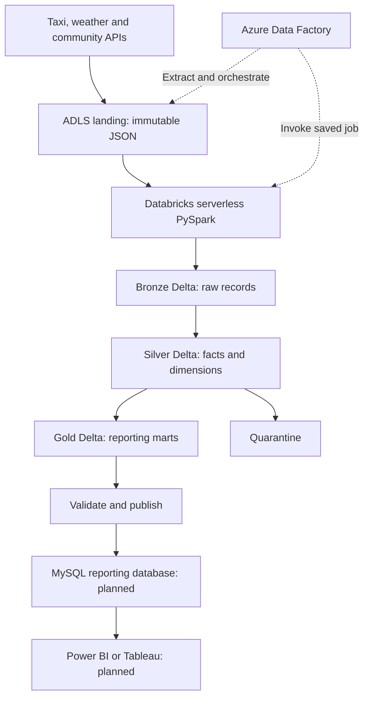

# Chicago Taxi Azure Lakehouse

An API-to-dashboard project using Azure Data Factory, Azure Databricks serverless PySpark,
ADLS Gen2 / Delta Lake and a planned MySQL reporting database.


## Current status

| Component | Status |
|---|---|
| UK South Azure resources | Created manually by the project owner |
| ADLS containers, external locations and Unity Catalog schemas | Created; file events disabled |
| Serverless PySpark storage test | Passed directly in Databricks |
| ADF invoking the saved serverless job | Passed |
| Taxi API → landing | Implemented and tested offline; new serverless ingestion job/live source test pending |
| Bronze/silver/gold transformations | Next implementation phase |
| Azure MySQL Flexible Server | Blocked by region/subscription provisioning restrictions |
| Local MySQL | Docker configuration provided; not yet verified on the owner's machine |
| Dashboard and full-year backfill | Not implemented/run in this repo |

This foundation records the user-confirmed Azure setup. CI is offline and does not independently
verify Azure resources. Nothing is deployed or scheduled automatically by this repository.

## Architecture



See [architecture](docs/architecture.md), [Azure setup](docs/azure_setup.md),
[local MySQL](docs/local_mysql.md) and [implementation roadmap](docs/roadmap.md).

## Layout

| Directory | Responsibility |
|---|---|
| `adf/` | Exported pipeline/linked-service definitions and authoring instructions |
| `databricks/notebooks/` | Thin notebook entry points; serverless connection smoke test |
| `src/chicago_taxi/` | Reusable extraction, transformations, quality and publishing code |
| `metadata/` | Versioned source definitions and reporting rules |
| `sql/mysql/migrations/` | Local database bootstrap and future reporting migrations |
| `infrastructure/` | Local Docker; future reviewed Azure infrastructure definitions |
| `tests/` | Functional checks now; integration, ETL validation and E2E suites to follow |
| `dashboards/` | Future versioned BI definitions |

## Local checks (Windows CMD)

Use Python 3.12 for alignment with the currently selected Databricks Runtime 16.4 LTS.
Serverless has its own managed environment; inspect its Python/Spark versions separately.

```cmd
python -m venv .venv
.venv\Scripts\activate
python -m pip install -e ".[test]"
python -m pytest tests/functional tests/integration -v
python tools/validate_metadata.py
```

No Azure credentials are needed for these checks. GitHub Actions and CircleCI run this foundation
suites; the integration suite uses a loopback HTTP fixture API. Delta ETL/E2E suites remain planned.

## Reporting limits

Taxi IDs identify vehicles, not drivers. Trip charges are not driver profit. Passenger gender
is absent. Miles × 1.609344 gives reported km, not an actual road route. Weather is modelled at
city level; unavailable measurements must not become zero or Dry. Preserve trips when geography
or weather is missing. Shortest-distance reporting excludes zero distances, retaining those rows.

Keep credentials and `.env` out of Git. Preserve PR review before merging. Code is MIT licensed;
source data retains its provider terms.

## Taxi API ingestion

See [landing ingestion setup](docs/taxi_ingestion.md) for the serverless package, saved job,
ADF parameters, raw manifests, reruns and live acceptance checks. No trigger is enabled.

## Bronze loading

See [bronze acceptance steps](docs/bronze_loading.md) for the explicit-schema Delta loader, manifest validation and replay checks. Live bronze acceptance is pending.

## ADF handoff

[Combined landing-to-bronze activation](docs/adf_bronze_handoff.md) uses one shared pipeline run identity for both saved serverless jobs. Individual cloud tests passed; combined live acceptance is pending.

## Silver warehouse

[Silver setup and validation](docs/silver_warehouse.md) builds typed trip facts, dimensions and quarantine records from a pinned bronze snapshot. Cloud acceptance remains pending.

## Three-stage ADF orchestration

[Landing → bronze → silver acceptance](docs/adf_silver_handoff.md) connects the three individually
validated serverless jobs. The combined three-stage pipeline requires live testing after merge;
no new wheel is required for this orchestration-only change.

## Gold reporting marts

[Gold setup and metric rules](docs/gold_reporting.md) creates five dashboard marts with reconciliation, measure coverage and publication lineage. Live gold/BI acceptance remains pending.

## Full ADF orchestration

[Landing → bronze → silver → gold acceptance](docs/adf_gold_handoff.md) connects the four individually tested jobs. No wheel change is required; retain gold’s working Standard v6 environment. Combined four-stage acceptance is pending.
